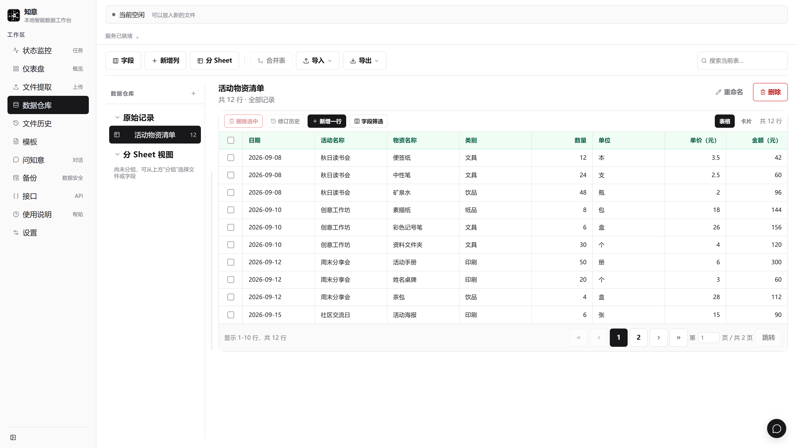

# 知意

知意是一款本地文档数据工作台。把 PDF、图片、Word 或 Excel 里的信息整理成可核对、可编辑、可导出的表格，随时回看原件和修改记录。

[下载 Windows x64 安装包](https://github.com/ha123-png/zhiyi/releases/latest) · [快速开始](docs/QUICK_START.md) · [使用说明](docs/功能说明.md) · [版本记录](CHANGELOG.md)

<p align="center">
  
</p>

## 设计哲学

**知意，是“知道意思”，不是“识别文字”。**

大多数文档工具把文字从图片或文件里取出来；“它是什么意思”仍要人来判断。知意用一套**微型指令集**表达你需要的字段、语义和规则，让通用多模态模型理解内容并生成结构化结果，再由程序校验、人工核对。

- **通用，而非专用：** 错题本、作业批改、发票、送货单、资料整理都可以换一套字段要求，不依赖为每种文件预置识别模板。
- **模型自由，而非本地优先：** 本地模型守住数据边界，云端模型可换来更快或更强的能力；同一条工作流按任务选择。使用云端服务时，本次请求涉及的文件内容会发送给你配置的服务商。
- **可信，而非“模型保证”：** 正确性来自规则校验、人工核对和来源追溯，不依赖模型一句“我猜的”。

**原件是证据，当前数据是事实，修订历史解释变化。**同一个文件的当前值只有一份，文件详情和数据仓库是两个工作入口；仪表盘、问知意、导出和接口读取相同的当前值。模型输出可能有误，重要数据仍应对照原件人工核验。

## 适合处理什么文件

- **发票、送货单和采购资料。** 用统一字段整理不同版式的单据，按整单信息和逐行明细核对，再按供应商、日期或其他业务字段分组。
- **会议纪要、新闻稿和其他临时资料。** 用自主提取整理每份文件的关键信息，或把常用字段做成模板供下一批文件复用。错题本、作业批改等场景也能用自定义字段和规则整理。
- **已有电子表格。** 可直接导入规整的表格，追加记录、筛选和汇总。提取任务入库后，可以从对应记录回看原件。

## 用一张送货单开始

1. **连接模型。** 使用本机的 LM Studio、Ollama，或填写兼容云服务的地址、模型名和 API Key。扫描件和图片需要视觉模型。
2. **选择模板并上传。** 示例送货单提取供货方、单号和日期，再按货品提取数量与单价。常用字段可以修改并复用，临时文件也可使用自主提取。
3. **对照原件核对。** 查看文件读取范围和校验问题，修正整单字段或明细。文件修订历史可查看修改前后的值。
4. **入库后继续使用。** 按供货方筛选、在仪表盘汇总、用问知意查询，或导出业务表。

打开空数据仓库即可使用示例送货单练习表格、卡片和编辑。

## 主要能力

| 功能 | 可以怎样使用 |
| --- | --- |
| 模板与提取 | 自定义文件级字段、明细字段、类型和规则，或让 AI 根据样例起草。可指定模板、在限定范围内智能匹配，或逐份文件自主提取。 |
| 任务与核对 | 批量排队，支持单任务与队列暂停、失败或取消后重试、重复文件确认和原件对照。可配置必填、范围、枚举、格式和计算规则。 |
| 原件与修订 | 托管原件供核对与再提取，并保留当前数据的修订历史。可选固定规则或 AI 建议命名，也可移动原件归档或保存副本。 |
| 数据仓库与导出 | 使用表格或卡片编辑同一份数据，支持搜索、筛选、分组、导入和实时合并。可导出 Excel、CSV、JSON，按需另存整表修订和提取范围。 |
| 仪表盘与问知意 | 基于当前数据统计和绘图，在授权范围内查找资料、引用来源和提出修改建议。可以预览并确认修改。 |
| API 与 MCP | HTTP API 提供读、写密钥。MCP 按能力独立授权，支持读取原件和修订历史。 |
| 备份与桌面更新 | 备份和恢复业务记录及内部原件。支持检查和下载更新，安装前备份并保留旧程序。普通卸载默认保留本地业务数据。 |

## Windows 安装与数据

从[发行页](https://github.com/ha123-png/zhiyi/releases)下载 Windows x64 安装包并核对 SHA-256。安装包未进行 Authenticode 代码签名，Windows 可能提示来源未知。已安装支持应用内更新的版本，可在「设置 → 关于知意」检查。旧版迁移与回退步骤见[升级使用说明](docs/升级使用说明.md)。

默认业务目录是 `%LOCALAPPDATA%\Zhiyi`，系统凭据管理器保存模型 API Key。业务备份包含记录及内部原件，外部归档、副本、模型与系统凭据需单独保管。知意默认把接口绑定在本机地址。使用云端模型时，与请求相关的内容会发送给所选服务商。重要数据请对照原件核验。 [隐私与数据边界](docs/PRIVACY.md)

## 本地开发

需要 Windows、Node.js、Python 3.12 和 [uv](https://docs.astral.sh/uv/)。

```powershell
git clone https://github.com/ha123-png/zhiyi.git
cd zhiyi
npm.cmd ci
uv sync --project apps/api --dev --python 3.12
npm.cmd run dev:safe
```

开发入口：Web `http://127.0.0.1:5180`，API `http://127.0.0.1:8010`；Worker 单进程，模型任务并发为 1。

## 项目与许可证

本项目由产品设计、真实工作流核验和 AI 编程代理协作完成。项目维护者负责需求、架构取舍、风险边界、代码与发行决策。欢迎提交具体的架构、质量、安全和交互问题。贡献方式见 [CONTRIBUTING.md](CONTRIBUTING.md)；安全问题请按 [SECURITY.md](SECURITY.md) 操作。

知意源代码采用 [Apache License 2.0](LICENSE) 发布。第三方依赖仍分别遵循其自身许可证；发行构建会生成 SBOM 与第三方许可证清单。
